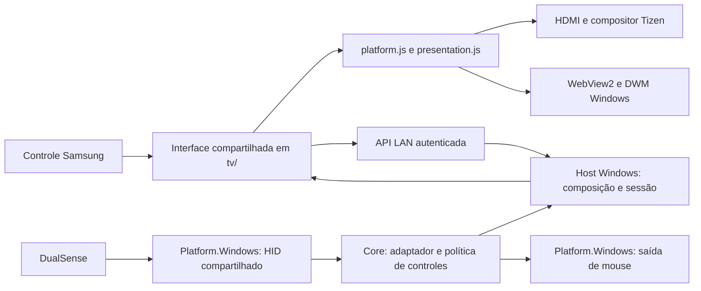

# Arquitetura do produto

O projeto existente foi preservado: o auxiliar Windows continua sendo o ponto de composição e `tv/` continua sendo a mesma interface empacotada para Tizen e servida ao WebView2. Não há cópias diferentes da biblioteca/menu para PC e TV.

## Fronteiras

- **Core (`net10.0`)** não importa WinForms, HID, WebView2, P/Invoke ou ASP.NET. Recebe tempo monotônico, sessão e foco como dados; devolve comandos sem executá-los. `IControllerAdapter` converte bytes em `ControllerState`. `ControllerProcessor` decide repetição, atalhos e gestos; `MenuNavigationGate`/`ControllerNeutralState` preservam foco e soltura estável.
- **Platform.Windows (`net10.0-windows`)** implementa `IControllerSource`, `IControllerConnection` e `IMouseOutput`. `DualSenseHid` abre leitura compartilhada, sem escrita/modificação de modo. `WindowsMouseOutput` executa somente os tipos de ação conhecidos. O projeto depende apenas do Core.
- **Host** faz composição das dependências, recuperação da leitura após 2 s sem relatório e encaminhamento exclusivo à página atual. API, catálogo, processos, áudio, telas e composição nativa continuam nos serviços existentes. `IGamePlatform`, `IAudioPlatform` e as implementações simuladas preservam testes isolados. A organização de todas essas integrações em assemblies adicionais permanece evolução futura; esta revisão separa fisicamente o subsistema de controles.
- **Interface (`tv/`)** compartilha biblioteca, seleção sincronizada, autenticação e navegação. `platform.js` encapsula IP da TV, HDMI, lançamento do viewer, informações de apps e limites do painel. `presentation.js` implementa fundo Tizen e PC, com descarte/visibilidade próprios. `stream-policy.js` decide qualidade; `stream.js` gerencia a sessão de vídeo; `stream-engine/` executa o motor sob demanda.

O protocolo de navegação existente é mantido: esquerda 37, cima 38, direita 39, baixo 40, confirmar 13 e voltar 10009, com indicação separada de repetição. Esses números são internos, nunca rótulos da interface.

## Ciclo de vida e segurança

Somente a sessão ativa permite movimento/clique de mouse. Um relatório de término não envia o último clique. Desconexão ou relatório inválido limpa gestos, atalhos, mouse habilitado e autorização de navegação. Reconexão exige nova soltura; não reaproveita um botão mantido da conexão anterior.

No PC, foco real e soltura inicial precedem navegação. Ao devolver ao jogo, o host espera neutralidade por 80 ms, com amostra recente. Isso preserva o DualSense nativo; não bloqueia jogos que leem input em segundo plano.

A TV mantém HMAC, identidade do PC e vínculo de recuperação independente. O painel PC tem cookie loopback/origem exata e bootstrap descartável. Nenhum adapter recebe chave de pareamento ou autorização para comandar processos arbitrários. Encerrar/mover jogos continua revalidando processo/janela; metadados nunca escolhem executável. Snapshot original de telas/áudio continua sendo restaurado depois da sessão.

## Entregáveis e limites

`Publicar-PC.ps1` produz executável e interface em pasta de preparação. `Empacotar-TV.ps1` prepara a mesma interface e pode assinar usando perfil local explicitamente indicado. Build, staging, assinatura, instalação e aceite físico são etapas separadas. CI não opera a TV, não altera monitores e não inicia jogos reais. Este código não foi certificado para a loja Samsung nem validado em todos os modelos de TV/gamepad/jogo.
