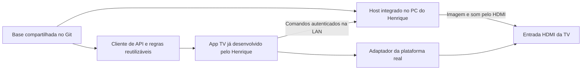

# Integrar um app TV existente ao Host 0.15

Este documento descreve o código da referência `dc1b281722db095d52a22bba3be426440f90ec28`. Não é uma promessa de API estável para todas as versões futuras. A 0.15 não possui endpoint de versão de protocolo/capacidades nem SDK independente para TVs. O campo `version` enviado a `/api/tv` é relatório do cliente, não negociação de compatibilidade.

## Preservar o app que já existe

O Host Windows fornece catálogo, estado e comandos. Um app próprio da TV pode consumir essa API sem adotar a interface Tizen inteira. Manter identidade do aplicativo, assinatura, permissões, entrada HDMI escolhida, armazenamento e ciclo de vida já validados no destino.



Separar no projeto derivado: cliente de API; estado e navegação; adaptador da TV; configuração local do PC. Evitar espalhar mudanças de fabricante por todos os arquivos compartilhados. O `LGPlatform` atual oferece referência para IP, fontes HDMI, seleção de entrada, viewer, encerramento e fundo; ainda não é um contrato multiplataforma completo. Revisar também detecção `desktop`, eventos, visibilidade e referências diretas a Tizen/Web APIs nos demais arquivos.

Fundo HDMI sob a biblioteca e troca automática de entrada dependem das APIs da TV real. Quando ausentes, manter fundo por arte e seleção manual de HDMI. Não adicionar streaming para encobrir ausência dessas APIs.

## Autenticação que o cliente precisa conservar

Referências executáveis: `tv/app.js` (`proof`, `api`, recuperação), `tv/crypto.js`, `Security.cs`, `PairingRecovery.cs`, `tests/integration.mjs` e `tests/pairing-recovery.mjs`.

1. Primeiro vínculo: código gerado **no próprio PC** por `/api/local-pairing`; TV envia `POST /api/pair` com `{"code":"..."}`. Resposta contém `identity` e `key` hexadecimal. Código é temporário/de uso único. Parear novamente troca a chave; não usar esse fluxo para um navegador de QA.
2. Antes de enviar comandos à máquina redescoberta, `GET /api/discover?challenge=...` deve confirmar a mesma identidade e prova `HMAC-SHA256(key, "discover\n" + challenge + "\n" + identity)`. IP/nome sozinhos não identificam PC confiável.
3. Nos comandos autenticados, assinar a mensagem abaixo usando os bytes da chave hexadecimal. O resultado vai em hexadecimal minúsculo no cabeçalho `X-LG-Signature`.

```text
METHOD + "\n" + PATH_WITH_QUERY + "\n" + TIME + "\n" + NONCE + "\n" + BODY
```

`METHOD` é GET/POST em maiúsculas; caminho começa em `/` e inclui a query exatamente enviada. `TIME` é Unix em milissegundos como texto (`X-LG-Time`); `NONCE` é novo por requisição (`X-LG-Nonce`; o cliente de referência gera 16 bytes aleatórios em 32 caracteres hex). `BODY` é o JSON UTF-8 exato transmitido; GET usa texto vazio. Não assinar uma serialização e enviar outra.

A verificação atual aceita tempo até 30 s de diferença, exige nonce de 16–100 caracteres sem quebra de linha e rejeita reutilização. O cliente deve ter relógio correto e tratar 401 sem repetir comandos com o mesmo nonce. CORS permite os cabeçalhos HMAC, mas não remove a exigência de autenticação.

O transporte é HTTP na LAN confiável; HMAC autentica, não cifra o conteúdo. Não colocar o Host em acesso público. A referência restringe interfaces/endereços a loopback e LAN 192.168.* com validação por sub-rede; fora desse cenário, reconciliar a adaptação já feita no destino e testar cliente/servidor juntos.

O painel PC usa cookie HttpOnly/loopback e bootstrap descartável. A TV usa HMAC; não portar cookies/bridge do WebView2 como atalho para autenticação LAN. Rotas privadas do painel não são uma API remota para a TV.

## Operações principais da referência

Todas as operações da tabela exigem HMAC para a TV. `id` vem do catálogo, nunca de caminho de executável recebido da página. Exemplos são contratos para revisão, não comandos para executar durante a migração.

| Método e caminho | Corpo / resultado relevante | Regra de uso |
| --- | --- | --- |
| `GET /api/status` | `state`, `artwork`, `controller`, `launcher`, `displays` | Catálogo em `state.games`; conservar campos desconhecidos e não depender de nomes visuais como IDs. |
| `GET /api/presentation` | `cable`, `stream`, com disponibilidade | Mostrar Cabo e explicar ausência. A variante HDMI não precisa apresentar Stream. |
| `POST /api/games/{id}/start` | `{"mode":"cable"}`; `accepted` | Prepara sessão/destino e abre ou continua sem duplicar processo. Depois o adaptador TV mostra HDMI. |
| `POST /api/games/{id}/focus` | `{}`; `focused` | Retorno ao jogo verificado; sozinho não substitui preparar destino via start/Cabo quando TV está inativa. |
| `POST /api/games/{id}/stop` | `{"force":false}`; `accepted` | UI confirma antes de enviar; aguardar estado fechado antes de abrir outro jogo. |
| `POST /api/games/{id}/stop` | `{"force":true,"confirm":"LOSE_UNSAVED_PROGRESS"}` | Só após confirmação explícita do risco pelo usuário. Não enviar automaticamente como retry. |
| `POST /api/games/{id}/move-to-tv` | `{}`; `moved` | Jogo já em execução; mantém menu para usuário depois selecionar Continuar. Não inicia/fecha jogo. |
| `GET /api/games/{id}/settings` | Nomes/metadados atuais | Separar identificação visual da identidade de lançamento. |
| `POST /api/games/{id}/settings` | `{"name":"..."}`, `{"name":null}` ou `{"storeId":"..."}` | Renomear/reassociar arte; não escolhe executável. |
| `GET /api/library/search?query=...` | Busca de metadados | Assinar a query exatamente codificada. |
| `POST /api/library/refresh` | `{}`; `count` | Atualização do catálogo sem executar jogos. |
| `GET /api/launcher/sync?after=...` | Revisão e seleção `id` | Long polling; timeout do cliente deve permitir espera (referência: 25 s). |
| `POST /api/launcher/selection` | `{"id":"..."}` | Compartilha seleção. Modais/foco local não são sincronizados integralmente. |
| `GET /api/audio`, `POST /api/audio` | Lista; seleção `{"id":"..."}` | IDs locais do endpoint, nunca prefixo fixo de outra máquina. |
| `GET /api/displays`, `POST /api/displays` | Estado; `{"monitorsEnabled":true}` | Sem sessão salva preferência; em sessão usa planejamento/rollback, não número de monitor fixo. |

Respostas de aceitação não comprovam jogo aberto, foco/imagem/áudio na TV ou estabilidade física. Atualizar estado e informar andamento/falha. A referência mantém polling de estado em aproximadamente 4 s; seleção usa long polling. Em `stop` também existem `nextGame`/`mode`; integrar esse fluxo só depois de revisar serialização e testes de troca. Não lançar manualmente o próximo jogo em paralelo.

Erros usuais: 400 para campos inválidos/confirmacão de força ausente, 401 para autenticação, 403 para restrição de origem/rota e 409 para conflito ou operação recusada. Nem toda resposta de erro possui JSON: Host/origem podem ser recusados antes do handler. Tratar status e corpo vazio sem derrubar o app. `request()` atual tem timeout padrão de 5 s e exceções por operação; reavaliar prazos no cliente próprio sem repetir mutações incertas automaticamente.

## Persistência e recuperação

Na referência web, o vínculo principal está em `localStorage['lazygaming']` e o independente em `localStorage['lazygaming-recovery']`. HDMI, seleção e outros ajustes têm chaves próprias. No Host, dados ficam em `%LOCALAPPDATA%/LazyGaming`.

`POST /api/recovery/enroll` exige HMAC válido da TV na LAN; `GET /api/recovery/discover` e `POST /api/recovery/restore` usam prova própria desse vínculo. Restore gera nova chave principal e prova de resposta; preservar o vínculo independente e validar essa prova. Loopback é recusado em produção para enrolar/restaurar. Não reimplementar só pelo resumo: portar fluxo e testes juntos.

Os dois vínculos são de uma TV confiável; esta versão não implementa cadastro multiusuário/múltiplas TVs. Nova instalação/origem/ID do app pode perder seu armazenamento: planejar migração antes de empacotar. Nunca copiar vínculo ou certificado da origem para o destinatário. Atualizar binários não exige parear novamente por padrão.

## Aceite do cliente próprio

Testar em ambiente isolado: mesma assinatura com acentos, query e GET vazio; assinatura errada, expirada e repetida; recuperação com prova inválida; PC mudou de IP; app suspenso/reaberto; erro sem JSON; timeout sem duplo lançamento; seleção sincronizada; sem jogo/mais de uma instância no comando mover; confirmação e Cancelar; perda de armazenamento sem reinicialização silenciosa do vínculo.

Validar fisicamente depois, em etapas com o dono do equipamento: comandos e biblioteca, remoto, HDMI/imagem/som, encerramento e restauração. Compilar WGT/IPK/APK, assinar, instalar e aprovar uso são evidências separadas. Pesquisar documentação oficial atual do modelo/sistema real antes de executar passos de developer mode ou instalação.
